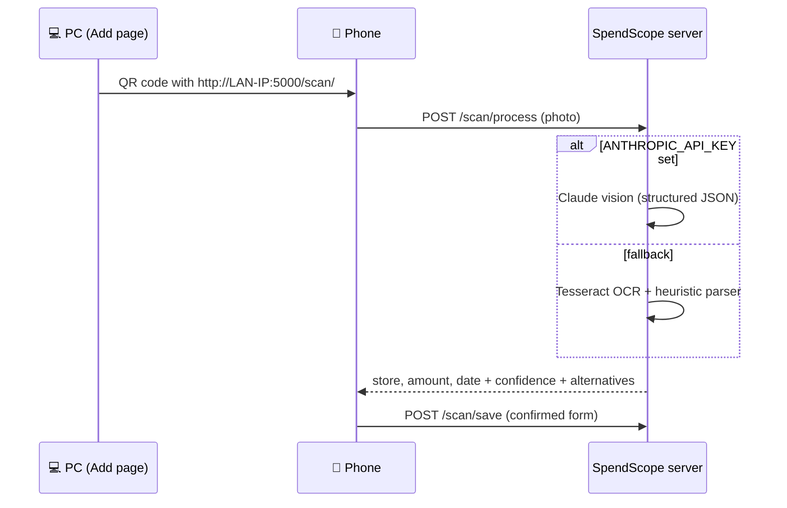

<div align="center">

# 💶 SpendScope

**A private, self-hosted household budget book with receipt scanning and a Bayesian spending forecast.**

[](https://github.com/ChristianAbele02/SpendScope/actions/workflows/ci.yml)


[](LICENSE)

Snap a receipt with your phone, confirm the pre-filled amount, and see how the month is going:
money spent, budget left and the probability of going over.

[Features](#-features) ·
[Quick start](#-quick-start) ·
[Receipt scanning](#-receipt-scanning) ·
[Configuration](#%EF%B8%8F-configuration) ·
[How the forecast works](#-how-the-forecast-works) ·
[Development](#-development) ·
[Privacy](#-privacy-and-safety-notes)

</div>

---

## ✨ Features

| | |
|---|---|
| 📊 **Dashboard** | Spend, remaining budget, transactions and daily average for the current budget period, a year-over-year comparison and per-category limit bars |
| 🔮 **Forecast** | End-of-period projection with a 90% credible interval and the probability of exceeding the budget |
| 📱 **Receipt scanning** | Scan a QR code on the PC, photograph the receipt on your phone, and get store, amount and date extracted by Claude vision or local Tesseract OCR |
| 🧾 **Expense list** | Filters (year, month, category, store, search), inline editing, bulk re-categorisation, undo for edits and deletions, Bayesian anomaly badges, CSV/JSON export |
| 📈 **Statistics** | Multi-year trends, year-over-year bars, stacked categories over time, best and worst months, shopping intervals for groceries and fuel |
| 💾 **Backups** | Automatic backups on a schedule, manual backups, download and one-click restore, configurable interval, retention and folder |
| 🎯 **Budgets** | Budget rules with effective dates, per-category monthly limits and a configurable period start day (e.g. payday) |
| 🏷️ **Auto-categorisation** | Store names mapped to categories by keyword; override per entry or in bulk |
| 🔗 **Store aliases** | Merge spellings ("REWE Markt" → "Rewe") for display and statistics without rewriting stored data |
| 🧠 **Receipt sample DB** | Upload reference receipts per store; the OCR parser learns which keyword marks the total |
| 🌍 **DE / EN** | Complete German and English interface, including locale-aware currency formatting |

Everything runs locally: one SQLite file, no account, no cloud service required.

## 🚀 Quick start

Requires **Python 3.11+**. Commands are for Windows PowerShell; on Linux/macOS activate with `source venv/bin/activate`.

```powershell
git clone https://github.com/ChristianAbele02/SpendScope.git
cd SpendScope

python -m venv venv
.\venv\Scripts\activate
pip install -r requirements.txt     # exact, tested versions
pip install -e . --no-deps

python run.py                       # opens SpendScope in its own window
```

`python run.py` opens a native desktop window (pywebview, using the Edge WebView2 runtime that
ships with Windows 10 and 11); closing the window stops the app. If pywebview is not installed,
`run.py` logs a warning and falls back to server mode. To run only the server and use a browser
instead, start `python run.py --server` and open **http://localhost:5000**.

In both modes the app also listens on your network so a phone can scan receipts, but only paired
devices get in: scanning the QR code on the **Add** page pairs the phone, and every other device
on the network gets "403 Forbidden". Add `--local` (e.g. `python run.py --local`) to close the
network side completely.

> [!NOTE]
> On Linux, pywebview additionally needs a GUI backend (GTK or Qt); see the
> [pywebview installation guide](https://pywebview.flowrl.com/guide/installation.html).
> `--server` works everywhere.

> [!TIP]
> The database (`data/expenses.db`) is created on first start, migrated to the latest schema on every
> start and seeded with the default budget rules. Before any schema change touches an existing
> database, a copy is saved to `data/backups/`.

### Backups

Open **Settings → Backups** to manage them.

- **Automatic:** while SpendScope is running it makes a backup when the app starts and then
  whenever the interval has passed (every 6 hours, daily, every 3 days or weekly; default
  daily). Only the newest automatic backups are kept (default 14).
- **Manual:** **Back up now** (or `flask --app run backup` in a terminal). Manual backups and the
  safety copies made before updates and restores are never deleted automatically.
- **Restore:** replaces the database with the chosen backup. The current state is saved first,
  so a restore can itself be undone.
- **Folder:** `data/backups/` by default. Pointing it at a synced folder (OneDrive, Nextcloud,
  ...) also protects against losing the disk.

Backups are full SQLite copies made with SQLite's backup API, so they are consistent even while
the app writes.

### Importing historical data

Place a CSV named `expenses_raw.csv` in the project root (it is git-ignored, so it never ends up
in the repository) and open **Import**, or use the CLI:

```powershell
flask --app run import-csv                 # append, skipping duplicates
flask --app run import-csv other.csv       # import a different file
```

| Column | Format |
|---|---|
| `Datum` | `DD/MM/YYYY` |
| `Laden` | store name, e.g. `Aldi`, or `Sonstige` with the real name in *Detail* |
| `Ausgaben` | amount in euros (comma or dot); negative for refunds |
| `Überschuss` | ignored |
| `Detail` | optional store detail |

The import only **reads** the CSV. By default it appends new rows and skips rows whose
date, store and amount already exist, so manually added and scanned entries are preserved.
A full replace is available but requires an explicit confirmation.

## 📱 Receipt scanning



Each field on the phone gets a confidence badge (green ≥ 85%, yellow ≥ 60%, red below), and
uncertain values come with tappable alternatives.

| Backend | When it is used | Setup |
|---|---|---|
| **Claude vision** | `ANTHROPIC_API_KEY` is set (backend `auto`) | `pip install -e ".[llm]"` and set the key |
| **Tesseract OCR** | No key, or the API call failed | Install the Tesseract binary (below) |
| *Manual* | Neither available | The form simply opens empty |

<details>
<summary><b>Installing Tesseract</b></summary>

| OS | Installation |
|---|---|
| Windows | [UB Mannheim installer](https://github.com/UB-Mannheim/tesseract/wiki); the default path is picked up automatically |
| Linux | `sudo apt install tesseract-ocr tesseract-ocr-deu` |
| macOS | `brew install tesseract tesseract-lang` |

For Tesseract, upload a few reference receipts per store under **Receipt DB**. SpendScope learns
which keyword (`SUMME`, `GESAMT`, `ZU ZAHLEN`, ...) marks the total and whether the amount sits on
the same or the next line.

</details>

## ⚙️ Configuration

All settings live in [`config.py`](config.py) and can be overridden with environment variables.

| Variable | Default | Purpose |
|---|---|---|
| `PERIOD_START_DAY` | `7` | Day a budget period starts (`1` = calendar months). With `7`, an expense on 2 April counts towards March |
| `ANTHROPIC_API_KEY` | unset | Enables the Claude vision backend |
| `RECEIPT_EXTRACTION_BACKEND` | `auto` | `auto`, `claude` or `tesseract` |
| `RECEIPT_EXTRACTION_MODEL` | `claude-opus-4-8` | Vision model; `claude-haiku-4-5` is cheaper |
| `TESSERACT_CMD` | UB Mannheim path | Tesseract binary; falls back to `PATH` if missing |
| `DATABASE_URL` | `sqlite:///data/expenses.db` | SQLAlchemy database URI |
| `RECEIPT_SAMPLES_DIR` | `data/receipt_samples` | Where reference receipt images are stored |
| `SECRET_KEY` | generated | Signs the session cookie; created once and kept in `data/secret_key` when unset |
| `LAN_TOKEN` | random per start | Pairing token in the QR code; set it to keep phones paired across restarts |
| `ALLOWED_HOSTS` | empty | Extra hostnames accepted besides IP addresses, `localhost` and the PC's name (comma-separated) |
| `FLASK_DEBUG` | `0` | `1` enables the debugger (never on an untrusted network) |

Budget rules, category limits and store aliases are managed in the UI under **Settings**.
Each budget period uses the newest rule whose *effective from* date is on or before the period's start.

## 🔮 How the forecast works

The dashboard forecast simulates the rest of the budget period as a sum of purchase streams:
one per category with at least 10 purchases in the last six periods (groceries, fuel, ...),
plus one pooled stream for the rare categories.

- **How often you shop.** Each stream's daily purchase rate gets a Gamma prior fitted to the
  previous six periods (empirical Bayes) and is updated with this period's purchases. Given the
  rate, the number of remaining purchases is Poisson.
- **When in the period you shop.** Spending is front-loaded: in the owner's data, average spend
  per day falls from 13.80 € in the first two weeks of a period to 8.20 € in the last ten days.
  A weekly profile, estimated from the last 24 periods and shrunk towards flat, turns calendar
  days into "effective days", so a busy first week does not get extrapolated to the whole period.
- **How much you spend per purchase.** Amounts follow a Gamma distribution (shape estimated per
  stream with Minka's approximation); its rate gets a conjugate Gamma prior from the historical
  purchases. A log-normal was tried first and scored worse in the backtest below (interval score
  366 vs. 331 before the weekly profile was added).
- **Combining them.** 20,000 Monte Carlo draws (fixed seed, so reloading never changes the
  numbers) give the median end-of-period total, a 90% credible interval and *P(total > budget)*.

Refunds lower the actual total but are excluded from the purchase model. The grocery and fuel trip
counts on the card are shown for context only. Details are in [`app/stats.py`](app/stats.py).

**Optional recency weighting.** Past periods can count less the older they are (exponential
decay with a half-life in periods), so the priors follow a rising or falling trend. It is
**off by default**: `--tune` preferred equal weights on the tuning periods. On the holdout, a
half-life of 2 to 4 periods reduced the under-forecast only from 36 € to 32 to 34 € and left
the interval score within 1%, too small a difference on 12 periods to justify switching it on.

**Optional shared monthly factor.** The model can also multiply all streams' rates by one common
monthly factor, so that a busy week of groceries raises the fuel forecast too. Its variance is
estimated from how strongly purchase counts of different categories move together. It is
**off by default**: in the backtest it widened the intervals and scored worse on both the tuning
and the holdout periods (see below). `--tune` keeps testing it as more data comes in.

### Checking the forecast

`scripts/backtest_forecast.py` replays every past period: at days 3, 10, 17 and 24 it rebuilds a
temporary database with only the expenses known on that day, forecasts, and scores the result
against the actual final total (interval coverage, interval score, MAE, bias, Brier score).
The real database is opened read-only.

```powershell
python scripts\backtest_forecast.py                # score the shipped model
python scripts\backtest_forecast.py --tune         # choose hyperparameters, check on a holdout
```

`--tune` grid-searches the prior strengths and the shared factor using **only the earlier
periods**, then scores the winner and the shipped settings on the **last 12 periods**, which the
search never saw. The shipped prior strengths came out of that procedure. Interval scores on the
owner's data (lower is better; 51 periods, 4 cut-off days each):

| Settings | Earlier 39 periods (tuning) | Last 12 periods (holdout) |
|---|---|---|
| Hand-picked before tuning | 312 | 291 |
| Hand-picked + shared monthly factor | 325 | 312 |
| **Tuned (shipped)** | **299** | **290** |

Tuning improved the periods it was fitted on, but on the holdout it only ties the hand-picked
values. The tuned intervals are narrower (258 € vs. 283 €) and still reach 90% coverage there.
In all settings the holdout forecasts were about 35 € too low on average, because spending rose
in the last year. Across all 204 forecasts the shipped model reaches 93% coverage, an MAE of
55.70 € and an interval about 350 € wide on day 3 and 140 € on day 24.

> [!IMPORTANT]
> Even the holdout is not fully clean: the model's structure (Gamma amounts, weekly profile) was
> designed while looking at all periods. Only periods that start after the freeze date in the
> script (`MODEL_FROZEN_ON`, currently 18 October 2026) are truly out of sample; the backtest
> reports them in a separate "after freeze" row. Move that date whenever the model changes.

### Anomaly badges

The "!" badge in the expense list marks purchases that a store's own history makes unlikely:
the posterior predictive probability of spending at least that much there is below 1%.
Amounts are modelled as Gamma within each store; each store's mean is shrunk towards its
category (worth three purchases), so a store with two visits is judged mostly by its category
and a store with 200 visits by itself. Every expense is scored leave-one-out, so a big purchase
cannot raise its own threshold. The tooltip shows the probability and the typical amount.

## 🗂️ Project structure

```text
SpendScope/
├── run.py                  # Entry point (desktop window / --server) and `import-csv` CLI
├── config.py               # Settings (env-overridable) and budget seed
├── app/
│   ├── __init__.py         # App factory, template globals
│   ├── models.py           # Expense, BudgetPeriod, ChangeLog, CategoryBudget,
│   │                       #   StoreAlias, ReceiptSample, StoreProfile, AppSetting
│   ├── parser.py           # Category keyword map, CSV import
│   ├── stats.py            # Periods, aggregations, forecast, anomaly detection
│   ├── extraction.py       # Claude vision receipt backend
│   ├── backup.py           # Automatic/manual backups, restore, backup settings
│   ├── forms.py            # Form validation, safe redirects
│   ├── security.py         # Host check, phone pairing, CSRF tokens
│   ├── translations.py     # DE/EN strings, t(), |eur and |pct filters
│   ├── routes/             # main, api, scan, settings blueprints
│   ├── templates/          # Jinja2 templates (Bootstrap 5 dark)
│   └── static/             # charts.js, style.css, vendored Bootstrap & Chart.js
├── migrations/             # Alembic schema migrations (Flask-Migrate)
├── scripts/                # backtest_forecast.py (forecast evaluation)
├── tests/                  # pytest suite (isolated temporary database)
├── requirements.txt        # pinned runtime lock (uv pip compile)
├── requirements-dev.txt    # pinned runtime + dev lock
└── data/                   # expenses.db, receipt samples, backups (git-ignored)
```

### Categories

| Category | Matched keywords |
|---|---|
| Lebensmittel | Aldi, Lidl, Rewe, Penny, Kaufland, Edeka, Marktkauf, Combi, Netto, Pollmeier |
| Tanken | Tanken |
| Drogerie | Rossmann, DM, Müller, Bravo, Rituals |
| Ausgehen | Ausgehen, Italiener, Subway, Türke, Pommes, Restaurant, Freibad, H2O |
| Einrichtung | Ikea, Jysk |
| Online | Amazon |
| Baumarkt | OBI, Toom, WEZ |
| Auto | Waschstraße, Parken |
| Sonstiges | Action, Laden and everything unmatched |

Matching is case-insensitive on word boundaries (`DM` never matches inside `Sandmann`).
Edit `STORE_CATEGORY_MAP` in [`app/parser.py`](app/parser.py) to extend it.

## 🛠️ Development

```powershell
pip install -r requirements-dev.txt
pip install -e . --no-deps

ruff check .        # lint
mypy                # type check
pytest              # tests (never touch data/ or expenses_raw.csv)
python scripts\backtest_forecast.py   # score the forecast on past periods (read-only)
```

GitHub Actions runs ruff, mypy and pytest on Python 3.11 and 3.12 with the pinned dev lock for
every push and pull request. The backtest needs a real database, so it runs locally only.
Dependency updates are done manually by regenerating the lock files (below).

Every new POST form needs `<input type="hidden" name="csrf_token" value="{{ csrf_token() }}">`;
`tests/test_security.py` fails if one is missing.

### Changing the database schema

Models live in `app/models.py`; every change needs a migration, otherwise
`tests/test_migrations.py` fails.

```powershell
flask --app run db migrate -m "add xyz column"   # review the file in migrations/versions/
flask --app run db upgrade                        # also runs automatically on app start
```

### Updating dependencies

Loose ranges live in `pyproject.toml`; the lock files pin every package, including transitive ones:

```powershell
pip install uv
uv pip compile pyproject.toml --extra llm --extra desktop --universal --python-version 3.11 -o requirements.txt
uv pip compile pyproject.toml --extra dev --extra llm --extra desktop --universal --python-version 3.11 -o requirements-dev.txt
pip install -r requirements-dev.txt   # then run the checks above
```

## 🔒 Privacy and safety notes

- All data stays on your machine. Receipt photos leave it only when the Claude backend is enabled.
- `data/` (database, receipt images, backups, session key) and `expenses_raw.csv` are git-ignored.
  Backups in `data/backups/` sit on the same disk as the database, so set a synced or external
  backup folder if the data matters to you.
- There are no user accounts. Instead, [`app/security.py`](app/security.py) runs three checks on
  every request:
  - **Pairing.** Only the PC itself and phones paired through the QR code get in; the pairing
    token changes on every start unless `LAN_TOKEN` is set.
  - **CSRF tokens.** Every form carries one, so another website cannot submit changes through
    your browser.
  - **Host check.** The `Host` header must be an IP address, `localhost` or the PC's name, which
    blocks DNS-rebinding attacks from websites.
- Anyone who can see the QR code (or its URL on the full-screen QR page) can pair a device, and
  traffic on the network is unencrypted HTTP. Use `--local` on networks you do not trust.

## 📄 License

[MIT](LICENSE) © Christian Abele
