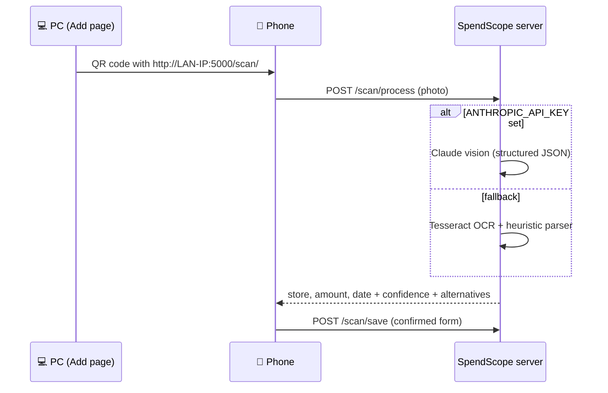

<div align="center">

# 💶 SpendScope

**A private, self-hosted household budget book with receipt scanning and a Bayesian spending forecast.**

[](https://github.com/ChristianAbele02/SpendScope/actions/workflows/ci.yml)


[](LICENSE)

Snap a receipt with your phone, confirm the pre-filled amount, and see how the month is going:
money spent, budget left and the probability of going over.

[Features](#-features) ·
[Quick start](#-quick-start) ·
[Receipt scanning](#-receipt-scanning) ·
[Configuration](#%EF%B8%8F-configuration) ·
[How the forecast works](#-how-the-forecast-works) ·
[Development](#-development)

</div>

---

## ✨ Features

| | |
|---|---|
| 📊 **Dashboard** | Spend, remaining budget, transactions and daily average for the current budget period, a year-over-year comparison and per-category limit bars |
| 🔮 **Forecast** | End-of-period projection with a 90% credible interval and the probability of exceeding the budget |
| 📱 **Receipt scanning** | Scan a QR code on the PC, photograph the receipt on your phone, and get store, amount and date extracted by Claude vision or local Tesseract OCR |
| 🧾 **Expense list** | Filters (year, month, category, store, search), inline editing, bulk re-categorisation, undo for edits and deletions, Bayesian anomaly badges, CSV/JSON export |
| 📈 **Statistics** | Multi-year trends, year-over-year bars, stacked categories over time, best and worst months, shopping intervals for groceries and fuel |
| 🎯 **Budgets** | Budget rules with effective dates, per-category monthly limits and a configurable period start day (e.g. payday) |
| 🏷️ **Auto-categorisation** | Store names mapped to categories by keyword; override per entry or in bulk |
| 🔗 **Store aliases** | Merge spellings ("REWE Markt" → "Rewe") for display and statistics without rewriting stored data |
| 🧠 **Receipt sample DB** | Upload reference receipts per store; the OCR parser learns which keyword marks the total |
| 🌍 **DE / EN** | Complete German and English interface, including locale-aware currency formatting |

Everything runs locally: one SQLite file, no account, no cloud service required.

## 🚀 Quick start

Requires **Python 3.11+**. Commands are for Windows PowerShell; on Linux/macOS activate with `source venv/bin/activate`.

```powershell
git clone https://github.com/ChristianAbele02/SpendScope.git
cd SpendScope

python -m venv venv
.\venv\Scripts\activate
pip install -r requirements.txt     # exact, tested versions
pip install -e . --no-deps

python run.py                       # opens SpendScope in its own window
```

`python run.py` opens a native desktop window (pywebview, using Edge WebView2 on Windows);
closing the window stops the app. To run only the server and use a browser instead, start
`python run.py --server` and open **http://localhost:5000**. In both modes a phone on the same
Wi-Fi reaches the app at `http://<your-PC-IP>:5000`.

> [!TIP]
> The database (`data/expenses.db`) is created on first start, migrated to the latest schema on every
> start and seeded with the default budget rules. Before any schema change touches an existing
> database, a copy is saved to `data/backups/`.

### Importing historical data

Place a CSV named `expenses_raw.csv` in the project root (it is git-ignored, so it never ends up
in the repository) and open **Import**, or use the CLI:

```powershell
flask --app run import-csv                 # append, skipping duplicates
flask --app run import-csv other.csv       # import a different file
```

| Column | Format |
|---|---|
| `Datum` | `DD/MM/YYYY` |
| `Laden` | store name, e.g. `Aldi`, or `Sonstige` with the real name in *Detail* |
| `Ausgaben` | amount in euros (comma or dot); negative for refunds |
| `Überschuss` | ignored |
| `Detail` | optional store detail |

The import only **reads** the CSV. By default it appends new rows and skips rows whose
date, store and amount already exist, so manually added and scanned entries are preserved.
A full replace is available but requires an explicit confirmation.

## 📱 Receipt scanning



Each field on the phone gets a confidence badge (green ≥ 85%, yellow ≥ 60%, red below), and
uncertain values come with tappable alternatives.

| Backend | When it is used | Setup |
|---|---|---|
| **Claude vision** | `ANTHROPIC_API_KEY` is set (backend `auto`) | `pip install -e ".[llm]"` and set the key |
| **Tesseract OCR** | No key, or the API call failed | Install the Tesseract binary (below) |
| *Manual* | Neither available | The form simply opens empty |

<details>
<summary><b>Installing Tesseract</b></summary>

| OS | Installation |
|---|---|
| Windows | [UB Mannheim installer](https://github.com/UB-Mannheim/tesseract/wiki); the default path is picked up automatically |
| Linux | `sudo apt install tesseract-ocr tesseract-ocr-deu` |
| macOS | `brew install tesseract tesseract-lang` |

For Tesseract, upload a few reference receipts per store under **Receipt DB**. SpendScope learns
which keyword (`SUMME`, `GESAMT`, `ZU ZAHLEN`, ...) marks the total and whether the amount sits on
the same or the next line.

</details>

## ⚙️ Configuration

All settings live in [`config.py`](config.py) and can be overridden with environment variables.

| Variable | Default | Purpose |
|---|---|---|
| `PERIOD_START_DAY` | `7` | Day a budget period starts (`1` = calendar months). With `7`, an expense on 2 April counts towards March |
| `ANTHROPIC_API_KEY` | unset | Enables the Claude vision backend |
| `RECEIPT_EXTRACTION_BACKEND` | `auto` | `auto`, `claude` or `tesseract` |
| `RECEIPT_EXTRACTION_MODEL` | `claude-opus-4-8` | Vision model; `claude-haiku-4-5` is cheaper |
| `TESSERACT_CMD` | UB Mannheim path | Tesseract binary; falls back to `PATH` if missing |
| `DATABASE_URL` | `sqlite:///data/expenses.db` | SQLAlchemy database URI |
| `RECEIPT_SAMPLES_DIR` | `data/receipt_samples` | Where reference receipt images are stored |
| `SECRET_KEY` | development key | Signs the session cookie; **set this** on a shared network |
| `FLASK_DEBUG` | `0` | `1` enables the debugger (never on an untrusted network) |

Budget rules, category limits and store aliases are managed in the UI under **Settings**.
Each budget period uses the newest rule whose *effective from* date is on or before the period's start.

## 🔮 How the forecast works

The dashboard forecast simulates the rest of the budget period as a sum of independent
purchase streams: one per category with at least 10 purchases in the last six periods
(groceries, fuel, ...), plus one pooled stream for the rare categories.

- **How often you shop.** Each stream's daily purchase rate gets a Gamma prior fitted to the
  previous six periods (empirical Bayes, capped at 45 days of prior weight) and is updated with
  this period's purchases. Given the rate, the number of remaining purchases is Poisson.
- **When in the period you shop.** Spending is front-loaded: in the real data the purchase rate
  in the last ten days of a period is about a third lower than in the first week. A weekly
  profile, estimated from the last 24 periods and shrunk towards flat, turns calendar days into
  "effective days", so the model does not expect the early pace to last.
- **How much you spend per purchase.** Amounts follow a Gamma distribution, which matched the
  real receipts' upper tail much better than a log-normal. Its shape is estimated per stream,
  and its rate gets a conjugate Gamma prior worth up to 25 historical purchases.
- **Combining them.** 20,000 Monte Carlo draws (fixed seed, so reloading never changes the
  numbers) give the median end-of-period total, a 90% credible interval and *P(total > budget)*.

Refunds lower the actual total but are excluded from the purchase model. The grocery and fuel trip
counts on the card are shown for context only. Details are in [`app/stats.py`](app/stats.py).

### Checking the forecast

`scripts/backtest_forecast.py` replays every past period: at days 3, 10, 17 and 24 it rebuilds a
temporary database with only the expenses known on that day, forecasts, and scores the result
against the actual final total (interval coverage, interval score, MAE, bias, Brier score).
The real database is opened read-only.

```powershell
python scripts\backtest_forecast.py
```

On the owner's data (51 periods, 204 forecasts) the current model reached 94% coverage of its 90%
interval, a bias of -2.50 € and an MAE of 56.40 €. The previous single-stream Normal model
reached 97% coverage, a bias of +19.90 € and an MAE of 60.30 €; their interval scores were
about the same (308 vs. 306).

### Anomaly badges

The "!" badge in the expense list marks purchases that a store's own history makes unlikely:
the posterior predictive probability of spending at least that much there is below 1%.
Amounts are modelled as Gamma within each store; each store's mean is shrunk towards its
category (worth three purchases), so a store with two visits is judged mostly by its category
and a store with 200 visits by itself. Every expense is scored leave-one-out, so a big purchase
cannot raise its own threshold. The tooltip shows the probability and the typical amount.

## 🗂️ Project structure

```text
SpendScope/
├── run.py                  # Entry point (desktop window / --server) and `import-csv` CLI
├── config.py               # Settings (env-overridable) and budget seed
├── app/
│   ├── __init__.py         # App factory, template globals
│   ├── models.py           # Expense, BudgetPeriod, ChangeLog, CategoryBudget,
│   │                       #   StoreAlias, ReceiptSample, StoreProfile
│   ├── parser.py           # Category keyword map, CSV import
│   ├── stats.py            # Periods, aggregations, forecast, anomaly detection
│   ├── extraction.py       # Claude vision receipt backend
│   ├── forms.py            # Form validation, safe redirects
│   ├── translations.py     # DE/EN strings, t() and |eur filter
│   ├── routes/             # main, api, scan, settings blueprints
│   ├── templates/          # Jinja2 templates (Bootstrap 5 dark)
│   └── static/             # charts.js, style.css, vendored Bootstrap & Chart.js
├── migrations/             # Alembic schema migrations (Flask-Migrate)
├── scripts/                # backtest_forecast.py (forecast evaluation)
├── tests/                  # pytest suite (isolated temporary database)
├── requirements.txt        # pinned runtime lock (uv pip compile)
├── requirements-dev.txt    # pinned runtime + dev lock
└── data/                   # expenses.db, receipt samples, backups (git-ignored)
```

### Categories

| Category | Matched keywords |
|---|---|
| Lebensmittel | Aldi, Lidl, Rewe, Penny, Kaufland, Edeka, Marktkauf, Combi, Netto, Pollmeier |
| Tanken | Tanken |
| Drogerie | Rossmann, DM, Müller, Bravo, Rituals |
| Ausgehen | Ausgehen, Italiener, Subway, Türke, Pommes, Restaurant, Freibad, H2O |
| Einrichtung | Ikea, Jysk |
| Online | Amazon |
| Baumarkt | OBI, Toom, WEZ |
| Auto | Waschstraße, Parken |
| Sonstiges | Action, Laden and everything unmatched |

Matching is case-insensitive on word boundaries (`DM` never matches inside `Sandmann`).
Edit `STORE_CATEGORY_MAP` in [`app/parser.py`](app/parser.py) to extend it.

## 🛠️ Development

```powershell
pip install -r requirements-dev.txt
pip install -e . --no-deps

ruff check .        # lint
mypy                # type check
pytest              # tests (never touch data/ or expenses_raw.csv)
python scripts\backtest_forecast.py   # score the forecast on past periods (read-only)
```

GitHub Actions runs all three on Python 3.11 and 3.12 with the pinned dev lock for every push and
pull request. Dependency updates are done manually by regenerating the lock files (below).

### Changing the database schema

Models live in `app/models.py`; every change needs a migration, otherwise
`tests/test_migrations.py` fails.

```powershell
flask --app run db migrate -m "add xyz column"   # review the file in migrations/versions/
flask --app run db upgrade                        # also runs automatically on app start
```

### Updating dependencies

Loose ranges live in `pyproject.toml`; the lock files pin every package, including transitive ones:

```powershell
pip install uv
uv pip compile pyproject.toml --extra llm --extra desktop --universal --python-version 3.11 -o requirements.txt
uv pip compile pyproject.toml --extra dev --extra llm --extra desktop --universal --python-version 3.11 -o requirements-dev.txt
pip install -r requirements-dev.txt   # then run the checks above
```

## 🔒 Privacy and safety notes

- All data stays on your machine. Receipt photos leave it only when the Claude backend is enabled.
- `data/` (database, receipt images, automatic backups) and `expenses_raw.csv` are git-ignored.
  Back up `data/expenses.db` regularly; it is a single file.
- The server binds to `0.0.0.0` so your phone can reach it. It has no login, so only run it on a
  network you trust, and set `SECRET_KEY`.

## 🧭 Roadmap

- [ ] Line-item extraction and per-item categories from receipts
- [ ] Desktop review queue for receipts uploaded from the phone
- [ ] Auto-save scans when all fields have high confidence
- [ ] CSRF protection for all forms

## 📄 License

[MIT](LICENSE) © Christian Abele
